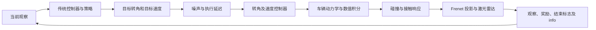

# F1TENTH 项目导读：从仿真闭环到残差控制

适用对象：学过深度学习和强化学习，希望在 F1TENTH 仿真环境中实践残差强化学习控制的读者。
核对日期：2026-10-17；代码基线：`ec3b1a4`，并包含 Windows 原生渲染适配。
后续实施路线见 [RESIDUAL_SAC_PLAN_ZH.md](RESIDUAL_SAC_PLAN_ZH.md)。本文是学习材料，不替代 Sphinx API 文档。

## 1. 先理解你拿到了什么

这是一个 1/10 比例赛车的仿真环境。环境负责把车辆动作转换为下一时刻的车辆状态，再计算传感器读数、碰撞、奖励和回合结束状态。它已经提供训练所需的环境接口，但你的 SAC 残差控制系统、任务定义和实验结果仍需要自己完成。

可以把整个项目看成三层：

| 层 | 本仓库已有内容 | 你的主要工作 |
|---|---|---|
| 仿真 | 车辆模型、积分、地图、激光雷达、接触求解 | 理解假设，选择适合的配置 |
| 环境 | Gymnasium 接口、观察、奖励、重置、结束条件 | 定义单车路径跟踪任务 |
| 决策与验证 | 纯追踪演示、JAX PPO 示例、训练适配器 | 可靠基线、残差控制、SAC 接入、评测与演示 |

本仓库没有 ROS 运行时，也没有实车部署链路。第一版成果应明确限定为仿真中的控制与鲁棒性验证。

## 2. 一次 step 实际发生了什么



默认 `timestep=0.01`，一次环境 step 推进 10 毫秒仿真时间。默认动作是 `[steering, longitudinal]`，具体解释为 `[目标转角 rad, 目标速度 m/s]`。它既不是方向盘像素，也不是油门百分比。

例如输入 `[[0.0, 2.0]]`，意思是“目标转角为零，目标速度为 2 m/s”。内部控制器先生成转角变化率和纵向加速度，积分器再更新车辆状态；速度不会瞬间变为 2 m/s。

原生动作形状为 `(num_agents, 2)`，单车也是 `(1, 2)`。`SingleAgentWrapper` 才把外部动作简化成 `(2,)`。环境检查形状，但不自动把输入裁剪到动作空间；残差合成层需要明确实施限幅。

入口分别在 [F110Env.step](f1tenth_gym/envs/f110_env.py) 和 [F110Simulator](f1tenth_gym/envs/simulator.py)。前者负责回合语义，后者负责物理与传感器。把新增学习逻辑放在外部控制层，容易单独调试和对比。

## 3. 观察中的量怎么读

默认观察是 `obs["agent_0"][字段名]`，字段包括 `std_state`、`state`、`scan`、`frenet_pose`、碰撞和计时信息。连续观察为 float32，存下来的观察与 info 应保持独立副本。

`std_state` 的顺序固定为：

```text
[x, y, delta, speed, yaw, yaw_rate, beta]
```

其中 `beta` 是侧偏角，单位 rad；它不是横向速度。需要车体坐标速度时，可由 `vx = speed*cos(beta)`、`vy = speed*sin(beta)` 得到。

公开的 `x/y`、派生 pose 和 Frenet 坐标都指向车辆质心（CoG）。经典后轴纯追踪控制器若使用后轴位置，应明确转换为：

```text
x_rear = x_cog - lr*cos(yaw)
y_rear = y_cog - lr*sin(yaw)
```

这个转换要和参考线定义一起验证；使用后轴追踪某条线时，不能自动假设质心对该线的横向误差严格为零。

Frenet 坐标为 `[s, ey, ephi]`：`s` 是沿参考线的弧长，`ey` 是横向偏差，`ephi` 是车身航向与参考线方向的夹角。默认参考是 centerline。`info["progress"][0]` 是本步经过首尾环绕修正的有符号 Δs，适合做进度奖励。

地图上的 centerline 与 raceline 是两条不同的线。centerline 定义默认 Frenet 框架，raceline 是优化驾驶线，通常还包含速度参考。默认出生点在 raceline 上，所以出生时 centerline 的 `ey` 非零是正常现象。若控制器跟踪 raceline，奖励也应计算对 raceline 的误差，不能同时惩罚它偏离 centerline。

`KINEMATIC_STATE` 适合检查接口，但只提供五个运动学量，不包含 Frenet 误差。名字带有 `FRENET` 的 `FRENET_DYNAMIC_STATE` 也不包含 `frenet_pose`。需要自选字段时，应使用 `ObservationType.FEATURES` 和 `ObservationConfig(features=...)`。

时间记录使用 `info["sim_time"]`。当前观察中的 `sim_time` 比 step info 落后一物理步，这是现有契约，不能据此误判策略时延。

## 4. 奖励与回合结束需要重新定义

默认奖励模式 `SURVIVAL` 每步返回 timestep，默认是 0.01。它的回报主要反映存活时间，不能直接代表跟踪精度或竞速水平。

`RewardMode.PROGRESS` 默认只奖励 Δs，也可以加入速度、时间和碰撞项。`RewardMode.CUSTOM` 的签名为：

```python
reward_fn(obs, action, info, terminated, truncated) -> float
```

回调发生在最终 info 组装后。需要基线动作、残差、动作历史等内部量的奖励，放到残差 wrapper 里更直接，避免依赖捕获可变全局状态的回调。

两个结束标志必须分别理解：

| 标志 | 当前环境语义 | 训练含义 |
|---|---|---|
| `terminated` | 碰撞或完成配置的圈数 | 真正的任务终止，目标不继续 bootstrap |
| `truncated` | 达到 `max_episode_steps` | 外部时间限制，通常需要从最终观察 bootstrap |

默认一圈结束、没有步数上限。训练短片段可以设置 `max_laps=None` 和明确的超时；全圈评测应固定起点和完整圈计时。随机在中段出生时，默认第一次过线会计圈；`count_partial_first_lap=False` 可以把第一段作为出场圈，随后才统计完整圈。

## 5. 车辆模型与现实偏差

`KS` 是便宜的运动学模型，适合接口和基础几何检查。`ST` 额外描述横摆与侧偏行为，适合主要控制实验。若研究低附着影响，应使用 ST：KS 方程并不使用摩擦系数 `mu`，在 KS 上随机 mu 不能证明低附着鲁棒性。

默认积分器为 RK4，可设置积分子步。首版保持默认物理时间步和模型，再研究控制频率；不要为了加快训练同时改变多个物理假设。

已有扰动能力包括：

- `ControlConfig`：转向／纵向命令噪声、固定 FIFO 执行延迟。
- `ObservationDelayWrapper`：延迟观察，奖励和 info 仍为当前时刻。
- `DomainRandomizationConfig`：每回合抽取车辆物理参数；每个环境中的所有车共享一次抽样。
- `LiDARConfig`：测距噪声、丢束、每回合固定的距离偏差。

这些能力让你能研究鲁棒控制，但仿真扰动测试本身不能证明已经实现 sim-to-real。

## 6. 当前的三种运行入口

| 入口 | 工作方式 | 本项目建议 |
|---|---|---|
| `gym.make("f1tenth_gym:f1tenth-v0", config=cfg)` | 注册的 F110Env，NumPy／Python 生命周期，部分 JAX 内核 | 理解流程、建立参考基线 |
| `JaxF110Env(cfg)` | 单环境 JAX 转移，每步仍回到 NumPy | 验证相同任务，实测后选择是否用于首版训练 |
| `JaxSimulator` 的 batch API | 环境批次保留在设备上 | 后续有吞吐瓶颈时再接入残差与 SAC |

仓库的 `examples/jax_ppo_training.py` 已把 PPO 的采样和优化放在 JAX 中。它是学习设备批量训练的范例，不能直接把 PPO 名字改成 SAC：SAC 还需要 replay buffer、双 Q、目标网络和 off-policy 更新流程。

可选 `F110SBXVecEnv` 已把批次物理留在设备上，但 stock SBX 的采集仍经过 NumPy；它目前还把策略输出直接映射为完整动作，没有现成残差合成扩展点。首版用普通 Gym wrapper 最容易检查正确性。

## 7. 认识项目的阅读顺序

| 顺序 | 文件 | 读完后应该能回答 |
|---|---|---|
| 1 | [quickstart.rst](docs/quickstart.rst) | reset/step 返回什么？为什么这一回合结束？ |
| 2 | [env_config.py](f1tenth_gym/envs/env_config.py) | 动作、模型、传感器、重置和任务分别在哪里配置？ |
| 3 | [waypoint_follow.py](examples/waypoint_follow.py) | 如何根据路径与 pose 输出转角？它有哪些演示简化？ |
| 4 | [f110_env.py](f1tenth_gym/envs/f110_env.py) | 奖励、进度和结束条件在哪一步计算？ |
| 5 | [simulator.py](f1tenth_gym/envs/simulator.py) | 命令如何经过延迟、动力学、接触和传感器？ |
| 6 | [action.py](f1tenth_gym/envs/action.py)、[single_track.py](f1tenth_gym/envs/dynamic_models/single_track.py) | setpoint 与物理输入有什么区别？ST 多了哪些状态？ |
| 7 | [wrappers.py](f1tenth_gym/envs/wrappers.py)、[rl.rst](docs/rl.rst) | 如何把环境交给单车 RL 算法？ |
| 8 | [test_reward.py](tests/test_reward.py)、[test_termination.py](tests/test_termination.py)、[test_wrappers.py](tests/test_wrappers.py) | 哪些行为已经有测试证据？ |

完成首版后再阅读 [jax_core.py](f1tenth_gym/envs/jax_core.py)、[batching.py](f1tenth_gym/envs/batching.py)、[jax_ppo_training.py](examples/jax_ppo_training.py)，理解纯函数状态、vmap、自动重置和设备执行。

## 8. 第一课：用几个 step 看懂契约

在项目根目录保存或交互执行下例。它使用本地已有的 Spielberg，关闭渲染并设置三步超时；第一次在缺地图的机器上运行仍可能下载地图。

```python
import gymnasium as gym
import numpy as np

from f1tenth_gym.envs.env_config import EnvConfig, TerminationConfig

cfg = EnvConfig(
    render_enabled=False,
    termination_config=TerminationConfig(max_episode_steps=3),
)
env = gym.make("f1tenth_gym:f1tenth-v0", config=cfg)
try:
    obs, info = env.reset(seed=42)
    print("observation fields:", sorted(obs["agent_0"]))
    print("action shape:", env.action_space.shape)
    print("standard state:", obs["agent_0"]["std_state"])
    for _ in range(3):
        action = np.array([[0.0, 2.0]], dtype=np.float32)
        obs, reward, terminated, truncated, info = env.step(action)
        print(
            "speed:", float(obs["agent_0"]["std_state"][3]),
            "reward:", reward,
            "progress:", float(info["progress"][0]),
            "obs time:", float(obs["agent_0"]["sim_time"]),
            "info time:", float(info["sim_time"]),
            "end:", terminated, truncated,
        )
        if terminated or truncated:
            break
finally:
    env.close()
```

观察四件事：速度逐步接近目标；动作的第一列是转角；默认奖励保持为 0.01；第三步因时间限制出现 truncated。然后把目标速度换为 1 m/s，解释为什么进度变了而默认奖励没变。

本例已在当前环境执行：第三步 `speed≈0.203 m/s`、`reward=0.01`、观察时间约 0.02 s、info 时间约 0.03 s，结束标志为 `(False, True)`。

Windows 调试使用当前虚拟环境即可；仓库给出的 CPU 安装入口为 `uv sync --frozen --no-group gpu`。Linux 服务器无渲染训练同样不需要桌面或 Xvfb；录制像素视频时才需要按渲染文档配置显示环境。

## 9. 本次已验证与仍待验证的边界

本次在 Windows 当前环境运行了单车封装、奖励、终止条件、无显示提示、平台选择和 SB3 checker 共 22 项测试，全部通过。平台选择测试使用 mock，未据此宣称真实 Qt 窗口或视频录制已验证。

后续检查已确认示例算出交点后使用了线段起点，同时仍使用设定前视距离的平方。独立实现已放在 [SAC_project/baseline.py](SAC_project/baseline.py)，采用精确交点、后轴参考点、实际目标距离与显式限幅。Spielberg 固定 2 m/s、种子 12345 的无渲染验证已完成三个完整圈，无碰撞。SAC 尚未训练，服务器吞吐尚未测量。后续 SAC 代码、测试与评测也统一放在 `SAC_project/`。

项目成果应清楚区分开源仿真能力、已有 Windows 适配，以及你后续新增的控制器、训练任务和实验证据。
