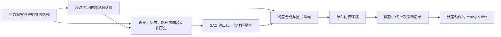

# SAC 残差控制实施计划

核对日期：2026-10-17；基线：`ec3b1a4` + 当前 Windows 渲染适配。
目标：形成可复现、可展示的仿真控制项目。
约束：Windows 本地做调试和短验证，Linux 租用服务器做正式训练；首版单车、已知地图。
项目导读见 [PROJECT_GUIDE_ZH.md](PROJECT_GUIDE_ZH.md)。项目代码统一放在
[SAC_project/](SAC_project/README.md)，包括后续残差、SAC 训练、评测和测试。
`SAC_project/baseline.py` 已实现纯追踪基线；其余学习功能仍为规划。

## 项目定位与第一版范围

建议项目名：**面向动力学与执行偏差的赛车 SAC 残差路径跟踪系统**。

工程问题是：一个经过合理调参的传统路径跟踪控制器，在附着、执行延迟或起始状态发生变化后，表现如何变化？有限幅度的学习修正能否提高成功率或减少误差？

首版先固定纵向速度方案，SAC 只输出转向残差。这更容易定位失败原因、比较控制效果，也能先完成有说服力的演示。两维转角／速度残差、MPC 基线、LiDAR 编码、超车和设备原生 SAC 是后续独立扩展。

建议争取用 10–15 个有效工作日完成首版闭环，再用 5–10 个工作日完善多种子和扰动实验。这是工程排期估计，训练是否获得改善需要实验判断。

展示分三级验收：Phase 2 后展示传统控制与残差接口；Phase 4 后展示单图单种子的已训练策略；Phase 5–6 后才形成能够支撑改善结论的多种子、保留地图实验。

## Phase 0：文档发现与已允许 API

已经核对项目文档、相关源码、示例、测试和本地依赖。实施时从下表的实际接口复制最小模式，并继续阅读本阶段所涉文件。

| 用途 | 已核对接口／来源 | 约束 |
|---|---|---|
| 环境构造 | `gym.make("f1tenth_gym:f1tenth-v0", config=EnvConfig(...))`；`docs/rl.rst:21` | 注册入口保持 F110Env |
| JAX Gym 入口 | `JaxF110Env(config, ...)`；`envs/jax_env.py:43` | deep import，每步仍有 host 边界 |
| 单车适配 | `SingleAgentWrapper(env)`；`envs/wrappers.py:17` | 仅单车；外部二维物理动作 |
| 自选字段 | `ObservationConfig(type=ObservationType.FEATURES, features=(...))`；`env_config.py:159` | 不凭预设名字猜字段 |
| 初态覆盖 | `reset(seed=..., options={"poses": poses})` 或 `{"states": states}`；`f110_env.py:544` | CoG pose；states 才能指定初速度 |
| 参考线投影 | `Track.cartesian_to_frenet(..., use_raceline=False, s_guess=None, use_s_guess=True)`；`track.py:523` | 用所选参考线；重置／瞬移需全局投影 |
| 纯追踪范例 | `PurePursuitPlanner.plan(..., lookahead_distance, vgain)`；`examples/waypoint_follow.py:299` | 返回顺序是 speed、steer；作为待验证范例 |
| 奖励 | `RewardConfig`；`f110_env.py:468`；`docs/rl.rst` | 默认 SURVIVAL，PROGRESS 需要 Frenet |
| 参数扰动 | `DomainRandomizationConfig(enabled=True, low=..., high=...)`；`docs/sim2real.rst` | low/high 是绝对物理值；每环境每回合一个共享车辆 |
| SAC 接入 | SB3 的 `SAC("MlpPolicy", env, ...)`；仓库 `docs/rl.rst:134` 有 SBX SAC 示例 | 仓库现有训练测试主要覆盖 PPO；需新增 SAC 验收 |
| 设备批次 | `JaxSimulator.reset_batch/step_batch_autoreset`；`docs/rl.rst` | 留作吞吐优化阶段；terminal 与 reset 观察不同 |

本地核实的组合是 Python 3.12.12、Gymnasium 0.29.1、JAX/jaxlib 0.11.1、SB3 2.9.0、SBX 0.28.0、Torch 2.10.0。SB3 2.9.0 的依赖允许 Gymnasium 0.29.1；不需要因猜测冲突而降级。

## 控制与数据契约

第一版的学习动作是 `z_t ∈ [-1, 1]`，形状 `(1,)`，代表归一化转向残差；发送给单车环境的仍是二维物理动作：

```text
delta_cmd = clip(delta_base + delta_res_max * z_t, delta_low, delta_high)
v_cmd     = clip(v_base, 0, v_cap)
env_action = [delta_cmd, v_cmd]
```

`delta_res_max` 初始可从 0.03–0.08 rad 的小范围试验，作为待调超参数记录。先用 `z=0` 检验“经过相同限幅后的纯基线”等价性。残差幅度有界只能限制干预大小，不保证行驶安全。

两维扩展时，再增加 `v_cmd = clip(v_base + v_res_max*z_v, 0, v_cap)`，并同步更新直接 SAC 对照的动作维度。回放池里的 action 应是策略实际输出的残差 z；合成物理动作与限幅结果另行记录。否则 critic 学到的动作语义会与 actor 不一致。

一次正式训练中冻结基线控制器的参数、残差幅度和特征定义。若改变动作合成规则，旧 replay 中的同一 z 将对应不同物理动作，需要开启新的实验或明确处理回放数据，避免把任务变化混入学习过程。



建议首版策略输入：所选路径的 `ey/ephi`、速度或车体 vx/vy、实际转角、横摆角速度、若干前方路径点或曲率、当前基线动作、上次残差与命令。角度使用一致的 wrap 或 sin/cos 表示，各量按明确的物理尺度归一化。

首版可以使用仿真状态和已知地图，但展示时必须写明定位与地图假设。mu 等真实参数仅用于诊断，避免作为策略输入泄漏测试场景。动作／观察延迟会带来部分可观测性；较长延迟实验需要足够的动作与观察历史，不能声称仅加一个上次动作就恢复了完整 Markov 状态。

默认物理频率为 100 Hz，首版基线、直接 SAC 和残差 SAC 均以该频率决策。后续尝试策略 20 Hz、每次动作保持 5 个物理 step 时，首个对照也让基线与残差共同以 20 Hz 更新，并保持完整合成动作不变；提前遇到 terminated/truncated 必须立即停止。明确记录实际经过的物理时间、累计 Δs、累计奖励与最后一次诊断。

“基线 100 Hz、残差 20 Hz”可作为独立的多频率架构扩展，保持期间每个物理 step 重算基线。此时需要专门对照，不能与 20 Hz 直接控制的结果一起归因为残差学习本身。

初始训练奖励保持简单：正向 Δs、归一化横向／航向误差惩罚、一次碰撞惩罚。需要时再逐项加入残差幅度与动作变化惩罚，避免一开始同时调许多权重。累计形式可写为：

```text
r = w_progress * sum(ds)
    - sum(dt * (w_y*(ey/e_scale)^2 + w_heading*(ephi/heading_scale)^2))
    - collision_cost * I(本决策期间发生碰撞)
```

每个奖励项都分别记录均值与范围。若加时间惩罚，按秒累计；改变 action repeat 时同时复核奖励和 discount 的时间尺度。若每 K 个物理 step 作一次决策并保持相同物理折扣尺度，可用 `gamma_policy = gamma_physics**K`，并使区间奖励累计与该折扣约定一致。固定速度跟踪版主要比较成功率与误差；两维竞速版再强调完整圈时间，不能只靠累积进度回报宣称圈速提升。

## Phase 1：冻结任务，建立可重复的纯追踪基线（约 2–3 个工作日）

**实现内容**：参考 `examples/waypoint_follow.py:46` 的路径查询和 `:187` 的控制公式，独立控制器已放入 `SAC_project/baseline.py`。当前默认跟踪 raceline，也可选择 centerline，出生参考随之保持一致。固定保守速度，主要实验使用 ST／RK4、100 Hz 与墙碰撞。LiDAR 关闭以减少成本，因为首版策略不使用它。

**必读与复制来源**：`docs/actions.rst`、`docs/dynamics.rst:225`、`docs/tracks.rst`、`waypoint_follow.py:260`、`tests/test_track.py`、`tests/test_reset.py`。

**验收**：直线与圆弧几何符合预期；闭合路径首尾查询连续；前视点与公式使用的距离一致；坐标帧有说明；同一配置和种子可复现。标准地图默认要求完成连续 3 个完整圈，输出轨迹、完整圈时间、横向误差和转角曲线。达不到稳定基线时先修正控制器或速度计划。

**防误用**：示例当前计算交点后使用线段起点，且观测是 CoG；复用前需验证。控制器 tuple 为 `(speed, steer)`，环境为 `[steer, speed]`。若改为 raceline 跟踪，误差奖励也切到 raceline。评测基线应在验证集合理调参，避免人为制造弱基线。

**交付物**：基线评测脚本、固定配置、CSV 轨迹、30–60 秒可重复演示。

## Phase 2：完成残差 wrapper 和环境验收（约 2–3 个工作日）

**实现内容**：拟新增 `SAC_project/features.py`、`SAC_project/env.py`；在 `SingleAgentWrapper(base_env)` 外封装残差环境，保留具名观察进行特征计算，再返回明确顺序的有限 float32 Box。wrapper 负责动作合成、限幅、历史清空、重复 step 和奖励；reset 后立即给出与当前状态对应的基线动作。

**必读与复制来源**：`envs/wrappers.py:17`、`tests/test_wrappers.py:47`、`envs/observation/fields.py`、`tests/test_reward.py`、`tests/test_termination.py`。

**验收**：零残差等价于相同执行条件下的基线；正负残差方向正确；极值命令受限且记录限幅比例；reset 清空历史；观察与空间一致且无别名。提前碰撞不再继续重复 step。时间上限与碰撞分别保留 truncated／terminated。运行 SB3 checker。

**防误用**：不要将 residual z 当成完整物理动作；不要依赖环境自动 clip；不要先 flatten 再猜字段索引。单车 `move_laterally=True` 当前不能直接提供随机横向偏差，需从 reset poses/states 接口建立显式扰动；检查出生点可行且不在墙内。

**交付物**：零残差／随机残差短回放和契约测试，仍不需要正式训练。

## Phase 3：接通 SAC、保存和恢复（约 1–2 个工作日）

**实现内容**：拟新增 `SAC_project/train.py`、`SAC_project/evaluate.py` 和配置记录。首版优先使用 SB3 SAC；它与普通 Gym residual wrapper 的边界清晰。声明并锁定首版 SAC 的训练依赖，给出明确安装入口；当前默认依赖组不安装 SB3，本地版本来自可选训练栈，不能据此假设干净服务器默认同步后也有它。SBX SAC 可作为同任务的备选实现，实测后决定。训练日志记录奖励分量、成功率、误差、残差幅度、限幅比例、仿真采样速度与更新速度。

**必读与复制来源**：仓库 `docs/rl.rst` 的单车环境与 SAC 接入示例；[SB3 SAC 官方文档](https://stable-baselines3.readthedocs.io/en/master/modules/sac.html)；`tests/test_jax_rl_compat.py:50` 的小型合成环境构造。

**验收**：干净环境可通过声明的安装入口导入首版训练库；本地只执行几十到几百步的更新验证；回放池可采样、loss 有限、策略可预测；模型保存后可加载并执行同一残差契约；分别验证碰撞终止与超时的 replay 标志。保存恢复至少包含模型、优化器／温度状态（由库负责的部分）、replay buffer、归一化状态、配置、随机种子和运行元信息。

短更新可先设置 `learning_starts=16`、`batch_size=16`、`buffer_size=256`，采集 64 个策略决策，并核对实际优化次数大于零、参数发生更新。此组数值只用于链路验收，正式训练另设配置。若采用固定 action repeat，让超时物理步数为 repeat 的整数倍；同时测试提前碰撞与最终观察，避免“只填 replay、没有更新”也被算作通过。

**防误用**：当前 PPO smoke test 通过不代表 SAC 训练链路通过。自动重置后必须使用最终观察构造超时目标，不能用新回合观察。依赖库保存恢复实现到什么程度就声明到什么程度，首版可在回合边界恢复，不承诺逐位延续同一物理状态。

**交付物**：有版本记录的 SAC 短更新与恢复证据，正式训练入口通过相同检查。

## Phase 4：Linux 服务器小规模试训，再扩大预算（约 2–4 个工作日及实测训练时间）

**实现内容**：服务器使用相同 commit、锁文件、地图文件和任务配置；先一张地图、一个种子、较短预算确认能学习，再扩大。正式训练关闭渲染。首轮同时比较 F110Env 与 JaxF110Env 在相同任务上的正确性和实测速度，选择更合适的入口。

**必读与复制来源**：`README.md` 的 CPU 安装模式、`docs/installation.rst`、`docs/rendering.rst`、`docs/jax_performance.rst`、`pyproject.toml`、`Dockerfile:63`。

**验收**：冷启动和 JIT 预热分别计时；报告预热后完整闭环的 transitions/s、梯度 updates/s、CPU／GPU 利用率和内存。GPU 计时做同步；把初始化、渲染和正式采样分开。运行短验收、保存模型、断开并恢复训练、拉回 Windows 做推理检查。

**防误用**：当前 Dockerfile 显式排除了 gpu group，是 CPU 镜像；不能仅加 `--gpus all` 就宣称已启用 GPU JAX。`sbx` extra 在 uv 管理的 Linux x86_64 克隆中选择 CPU Torch，适合 SBX 的宿主基础设施；普通 pip 安装不执行这条 uv 源配置。若选 PyTorch SAC GPU，应单独定义依赖方案。小型 MLP 的学习器未必受益于 GPU，先测瓶颈。

**预算安排**：先短租确认依赖、驱动和每小时有效采样量，再决定正式实验预算。无须首轮购买多 GPU 或最高显存实例。当前 CUDA13 JAX 官方要求 Linux GPU 架构 SM≥7.5、驱动≥580；租机前依据[官方安装文档](https://docs.jax.dev/en/latest/installation.html)重新核对，必要时另行锁定兼容的 CUDA12 配置。

**交付物**：可重放的运行清单、一次有效训练结果、恢复记录、Windows 推理演示。

## Phase 5：证明改善来自哪里（首版约 3–4 个工作日，随后扩展）

**实现内容**：冻结训练、验证、测试地图与种子，测试集不用于选超参数或 checkpoint。首版至少一张训练地图和一张保留测试地图；后续扩为多训练地图与独立保留地图。每个方案最终至少 3 个训练种子，每种测试场景使用预先固定的一组评测种子，例如 20 个。

**必读与复制来源**：`docs/reproducibility.rst`、`docs/sim2real.rst`、`tests/test_domain_randomization.py`、`tests/test_lap_counter.py`、`tests/test_jax_rl_compat.py`。

| 对照 | 要回答的问题 |
|---|---|
| 合理调参的纯追踪 | 已知传统方案能达到什么水平？ |
| 直接转向 SAC + 同一纵向控制 | 在相同动作维度与任务下，残差结构是否有帮助？ |
| 纯追踪 + SAC 转向残差 | 成功率与跟踪误差是否改善？ |
| 残差训练无 DR／有 DR | 参数随机化是否改善测试扰动下的表现？ |

直接 SAC 与残差 SAC 使用相同传感信息、控制频率、速度上限、奖励、训练预算和模型容量；两者均可获得计算出的基线动作作为特征，但前者直接输出完整转角。两维版本再比较两维直接控制与两维残差。报告墙钟成本和采样数，两种预算口径都清楚。

先测 nominal，再分别测附着、执行延迟、初始横向／航向偏差，最后测组合扰动。ST 才用于附着实验；延迟用 physics step 换算成毫秒，不把不同频率下的“2 步”当成同样的物理扰动。训练覆盖区间与测试区间写明；区间外测试只能按实际结果报告。

**验收指标**：固定超时下完整圈成功率、碰撞率、CoG 对所选参考线的横向误差 RMS／P95、完整圈时间、转角变化、残差大小与限幅比例、推理延迟。失败回合保留在成功率与误差统计中；圈时间只在成功回合统计，同时展示成功率，避免只展示幸存者。

**防误用**：随机中段出生的第一次过线不是完整圈；用固定同起点或显式 out lap 方案。同种子不保证 F110Env 和 JaxF110Env 的噪声逐位配对，也不保证不同 DR 配置具有相同传感器随机流。验证可复现性与配对初态分别处理。

**交付物**：对照表、训练曲线、轨迹叠图、失败案例和扰动演示。若未超过基线，先分析错误、奖励、观测与残差容量，按真实结论写结果。

## Phase 6：最终验收与展示材料

**实现内容**：按 Phase 0 的接口表逐项核对最终代码；运行新增契约测试与相关回归测试。检查 residual、direct 和 baseline 三种模式是否共享同一评测入口；查找动作顺序颠倒、错误字段名、遗漏限幅、reset 未清空历史和 timeout 与终止混用。

**必读与复制来源**：最终实现涉及的源文件、`tests/test_wrappers.py`、`tests/test_reward.py`、`tests/test_termination.py`；若改到 JAX 纯核心，再运行 `tests/test_migration_seam.py` 及对应 batch tests。

**验收**：Windows 能加载服务器模型并完成固定场景回放；Linux 从记录的依赖和地图重新启动。形成架构图、方法说明、对照实验表、60–90 秒视频、失败案例和复现说明。

**防误用**：新增文件名称在实现前属于规划；不把开源仿真器、已有 PPO 或原有 Windows 适配写成自己从零开发。没有实车实验就明确标注仿真验证；没有真实测量就不填改善百分比。

项目介绍应围绕实际完成的控制架构、坐标／动作契约、奖励设计、SAC 训练闭环和实验结果组织。定量表述使用已经测得的数据，并同时给出测试地图、扰动范围和成功率口径。

## 后续优化的触发条件

| 现象 | 对应的下一步 |
|---|---|
| 基线稳定，但转向残差无法解决速度导致的失败 | 设计曲率速度计划，再扩展速度残差 |
| 长延迟下依赖历史，当前特征不足 | 明确历史窗口，再考虑有记忆的策略 |
| 训练时间主要耗在宿主仿真与数据搬运 | 把基线、特征与残差合成移到 JAX batch，并验证 terminal 路径 |
| 需要更多控制方法比较 | 在同一基准加入 Stanley 或 MPC |
| 需要感知相关项目深度 | 增加稀疏 LiDAR 或编码器，并定义有意义的传感器扰动任务 |

## 平台与数据记录清单

Windows 用 CPU 验证；JAX 官方不支持原生 Windows NVIDIA GPU。训练与回放共享模型、特征顺序、尺度、残差幅度、控制频率和限幅配置。跨系统以数值容差和行为指标检查，不要求轨迹逐位一致。

`maps/` 被 Git 与 Docker 忽略，服务器不会自动拥有本地地图。当前缓存的 Spielberg 有 centerline 与 raceline CSV；正式实验预置地图并记录文件校验和。无 centerline 地图虽有兼容路径，但不应未经验证直接用于 Frenet 跟踪与整圈指标。

现有 `examples/telemetry_plot.py:16` 仍提前设置 Linux 的 Qt／OpenGL 平台，Windows 演示若复用它需单独处理。真实视频渲染需独立验收；普通无渲染训练不需要 Xvfb。

每次运行至少保存 commit、工作区差异、Python／库版本、地图校验和、完整配置、train/eval seeds、观察字段顺序与尺度、残差幅度、控制周期、checkpoint 选择规则和评测结果。初期 CSV + JSON／TOML + 本地图表足够，日志工具可按需要加入。

## 已完成的规划验证

2026-10-17 在当前 Windows 环境运行以下相关检查，结果 **22 passed**：

```text
tests/test_wrappers.py
tests/test_reward.py
tests/test_termination.py
tests/test_renderer.py::TestNoDisplayGuidance
tests/test_renderer.py::TestPlatformRendering
tests/test_jax_rl_compat.py::TestOptionalJaxRlCompatibility::test_stable_baselines3_environment_checker
```

以上为规划时的基础环境检查记录。后续已实现 `SAC_project/baseline.py`，并在 Spielberg、种子 12345、固定 2 m/s 下完成出场圈之后的三个完整圈：169.17、169.16、169.17 s，无碰撞、无限幅。详细运行方式与误差统计见 [SAC_project/README.md](SAC_project/README.md)。SAC 训练与实际 GPU 测速尚未执行。

方法参考：[Residual Reinforcement Learning for Robot Control](https://arxiv.org/abs/1812.03201) 提供传统控制与学习修正组合的思路；本文将其作为本项目设计依据，不宣称已经复现该论文实验。[SB3 2.9.0 的依赖声明](https://github.com/DLR-RM/stable-baselines3/blob/v2.9.0/setup.py)用于核对本地训练栈兼容性。
